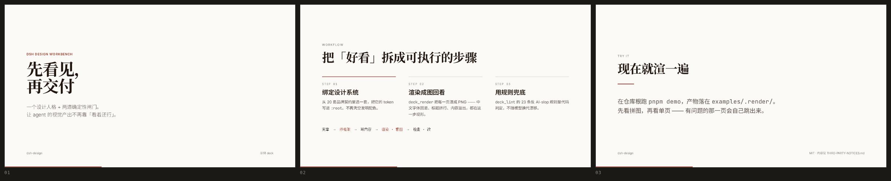

# dsh-design

**给 DSH 装上「设计人格」和两道确定性闸门 —— 让 agent 的视觉产出不再靠「看着还行」。**

> **English** — A design workbench for [DeepSeek Harness](https://github.com/deepseek-ai):
> flip a design persona on inside one session (`/design`), then gate the output with
> two deterministic checks — render it and *look at it* (`deck_render`), and lint it
> against 23 anti-AI-slop rules (`deck_lint`). Ships with a 20-system design library
> and a 165-template skill. MIT; content provenance in
> [`THIRD-PARTY-NOTICES.md`](./THIRD-PARTY-NOTICES.md).



*上图是 [`examples/quickstart-deck.html`](./examples/quickstart-deck.html) 的真实渲染结果（`pnpm demo`）。*

---

## 它解决什么问题

设计类任务最大的失效模式是**「代码看着对、渲染出来不对」**：

- 中文字体回退成默认无衬线，标题气质全丢
- 行高不够，中文两行贴在一起
- 色板没绑对，出来一片灰
- 内容溢出容器被裁掉

**规则再全也抓不到「这页不好看」。** 只有把渲染结果给模型看，它才知道要改什么。
但「让模型看一眼」这件事本身会失效，而且**失效时没有任何症状**：

> 我们实测过：一份 12 页的 deck，渲染工具如实报告「12 page(s) 全部渲好」，
> 而实际交出的 **12 张图字节完全相同** —— 翻页没生效，模型看到的是第 1 页重复 12 次。
> 它会据此宣布「已验收」。

所以这个仓库的每一处设计都围绕一件事：**让闸门不可能静默失效。**

---

## 仓库里有什么

| 包 | 干什么 | 关键文件 |
|---|---|---|
| **dsh-design-stance** | `/design` 在**同一个会话里**穿脱设计人格，不用切会话、不用换 preset | `index.js` · `client.js` |
| **dsh-design-prompt** | 设计宪章**内容模块**（8 章 / 77 KB）。**故意不是插件** —— 没有 `apply()`，装错也伤不到人 | `content/*.md` |
| **dsh-deck-render** | 把 HTML deck 渲成 PNG，让模型**看自己的产出**。工具 `deck_render` + 独立 CLI | `lib/render.js` |
| **dsh-deck-lint** | 23 条反 AI-slop 规则的**代码判定**（不随模型换代漂移）。工具 `deck_lint` | `src/lint.js` |
| **dsh-media-gen** | BYOK 图片 / 视频 / 语音生成。按**协议**适配而不是按厂商（16 个模型 / 2 套协议） | `lib/providers.js` |
| **skills/od-deck** | 6 步工作流 + 20 套品牌设计契约 + 版式库 + 反 AI-slop 规则 | `SKILL.md` |
| **skills/hyperframes** | HTML 视频合成（字幕、配音、音频反应动效、转场） | `SKILL.md` |

**测试：307 项断言，全绿。** `npm test` 一次跑完（渲染与媒体适配器都不出网、不花钱）。

---

## 5 分钟上手

```bash
# 0) 前置：Node 22.19+ 或 24+，pnpm，以及一份可用的 DSH
node -v && pnpm -v

# 1) 装插件（一条命令，会自动加进 profile 的 bundles）
dsh plugin --profile web add dsh-design-stance
dsh plugin --profile web add dsh-deck-render
dsh plugin --profile web add dsh-deck-lint
dsh plugin --profile web add dsh-media-gen

# 2) 装技能（symlink 进 ~/.dsh/skills）
git clone https://github.com/weiza0v0/dsh-design.git ~/dsh-design && cd ~/dsh-design
./scripts/install-skills.sh

# 3) 重启 DSH（插件不像 skill 那样热加载）
pkill -f "dsh web" && sleep 3 && cd ~ && nohup dsh web >| /tmp/dsh-web.log 2>&1 & disown
```

> ⚠️ 第 1 步走的是 npm 注册表。**本仓库尚未发布到 npm**，所以现在请用下面的
> 「从源码装」，或等发布后再回来用这一条。

<details>
<summary><b>从源码装（当前可用）</b></summary>

```bash
cd ~/dsh-design && pnpm install

cd ~/.dsh/profiles/web
# 在 package.json 的 dependencies 里加（路径按你的实际位置改）：
#   "dsh-design-stance": "link:/home/<你>/dsh-design/packages/design-stance"
#   "dsh-deck-render":   "link:/home/<你>/dsh-design/packages/deck-render"
#   "dsh-deck-lint":     "link:/home/<你>/dsh-design/packages/deck-lint"
#   "dsh-media-gen":     "link:/home/<你>/dsh-design/packages/media-gen"
#   "dsh-design-prompt": "link:/home/<你>/dsh-design/packages/design-prompt"   # ← stance 的依赖
#
# 并在 dsh.profile.bundles 里加上这四个**插件**包名。
# （design-prompt 是内容模块，**不要**加进 bundles）

pnpm install
```

每个插件自带的 `cordis.patch.yml` 会把自己插进配置树，**不用**再手写 `insert`。
装完重启 DSH。

> `link:` 是符号链接，改仓库里的代码即刻生效（但 DSH 仍要重启才会重新 `import`）。
</details>

新会话里：

```
/design          ← 穿上设计人格（工具 design_stance 也能让模型自己穿）
/design status   ← 看当前状态
/design off      ← 卸下
```

> 斜杠命令在**全新会话的欢迎页**上不可用（DSH 通例，`/plan` 也一样）。
> 所以额外提供了**工具** `design_stance` —— 它随 agent 存在，**第一轮就能用**。

**不想装、只想先看看效果？** 仓库根直接跑：

```bash
pnpm install
pnpm exec playwright-core install chromium   # 首次需要：渲染要一个浏览器
pnpm demo                                # → examples/.render/，约 12 秒
```

> 如果你机器上已经装了 Chrome / Chromium（或已在跑调试端口），
> 第一条安装命令可以跳过 —— 渲染器会自己找到它。
> 找不到时它会明确告诉你三选一怎么办，而不是丢一串 Playwright 的路径报错。

---

## 设计是怎么跑起来的

```
        用户说「做个 deck」
                │
                ▼
   ┌────────────────────────┐
   │  /design  →  设计人格   │  宪章 77 KB 作为 system prompt 的一个 section
   │  （标准人格 + 追加）    │  工具指引不动 —— 联网搜索、子代理照常可用
   └────────────────────────┘
                │
                ▼
   绑定设计系统 → 抄框架 → 写内容 → todo_write
                │
                ▼
   ┌─────────────── 门一 · 用眼睛看 ───────────────┐
   │  deck_render → read_image（拼图，一次看全）   │
   │  distinct == pages 才算真的看到了每一页       │
   └──────────────────────────────────────────────┘
                │
                ▼
   ┌─────────────── 门二 · 用规则查 ───────────────┐
   │  deck_lint → 0 个 P0 才算过                    │
   └──────────────────────────────────────────────┘
                │
                ▼
              改 · 重渲 · 重查 → 交付
```

**顺序不能反**：先看图（抓「不好看」），再查规则（抓「违规」）。
规则查不出「这页不好看」，看图查不出「用了默认靛蓝」—— 两者不可替代。

---

## 两个闸门各自的坑（都是实测踩出来的）

### 门一 · `deck_render`

| 问题 | 现象 | 现在怎么做 |
|---|---|---|
| 翻页押注单一类名 | 模板用 `.slide.is-active`，工具只翻 `.active` → **N 页全同**，还报成功 | `active` / `is-active` 都翻，再叠内联样式兜底 —— **不依赖任何框架的类语义** |
| 运行时克隆页被当成独立页 | 概览面板把每页 `cloneNode` 一份，`querySelectorAll('.slide')` 数到 2N 个 | 只看**祖先是否被隐藏**，不看元素自身的 `display` |
| 静默失效无从察觉 | 交给模型一叠相同的图 | 返回 `distinct` 字段 + SHA1 指纹自查，出现像素级重复就 warning |

### 门二 · `deck_lint`

23 条规则、零构建、零运行时依赖。它是**移植**自 OpenDesign 的 `lint-artifact`
（规则集完全一致，TypeScript → 无依赖 ESM JS）—— 详见
[`THIRD-PARTY-NOTICES.md`](./THIRD-PARTY-NOTICES.md)。

---

## 已知限制（写清楚，不藏）

- **`deck_render` 默认优先复用已在跑的调试端口。** 如果你的日常浏览器开着
  `--remote-debugging-port=9223`，渲染会在**那个浏览器里**开标签页。
  想无感：`bash packages/deck-render/scripts/start-headless-browser.sh 9333`，
  然后传 `cdp="http://127.0.0.1:9333"`。
- **已在 Linux / WSL 上实测**；macOS / Windows 原生路径未经实测（代码里有分支，欢迎报 issue）。
- **容器里渲染**要设 `DECK_RENDER_ARGS="--no-sandbox --disable-dev-shm-usage"`。
  默认**不**关沙箱 —— 那是安全降级，不该为了 CI 方便让所有人承担。
- **`media_gen` 是 BYOK**，没有 key 时 `media_models` 会如实报告，不会偷偷走别的通道。
- **设计素材只有 20 套设计系统**（上游有 154 套）。够用，但不是全集。
- **两种翻页约定并存**：html-ppt 框架用 `.slide.is-active`，OpenDesign 的章程描述
  用 `.slide.active`。渲染器两套都认，但你手写 CSS 时要知道自己用的是哪套。

---

## 开发

```bash
pnpm install
npm test              # 契约检查 + 全部工作区测试（307 项）
npm run test:bundles  # 只跑「每个插件包都能被装得上」的契约检查
```

`npm run test:bundles` 守的是一条**极易踩、且本地毫无症状**的规则：
DSH 的 plugin-manager 只接受**声明了 `dsh.bundle.patch` 的包**，
否则回 `not-a-bundle` 并**回滚安装**。本仓库最初 5 个包里有 4 个踩了这个坑 ——
手工往 profile 里写 insert 一切正常，只有陌生人装不上。

**想深入改这个仓库**，先读 [`docs/architecture.md`](./docs/architecture.md) ——
它讲的是几条踩过坑才明白的硬约束（包名三处必须一致、`complete: true` 是陷阱、
第三方插件绝不能往会话日志写自定义事件类型、客户端槽位 `kind:"list"` 必须带 `id` …）。

---

## 许可

- 本仓库自己的代码：**MIT**（[`LICENSE`](./LICENSE)）
- `skills/od-deck/**` 内含第三方素材，其中 `design-systems/` 等来自
  [OpenDesign](https://github.com/nexu-io/open-design)（**Apache-2.0**，
  全文见 [`skills/od-deck/LICENSE-APACHE-2.0`](./skills/od-deck/LICENSE-APACHE-2.0)）

**逐文件的来源与修改说明见 [`THIRD-PARTY-NOTICES.md`](./THIRD-PARTY-NOTICES.md)。**
改动任何第三方内容时，请同步更新那份文件 —— 这是 Apache-2.0 的要求，不是礼貌。
